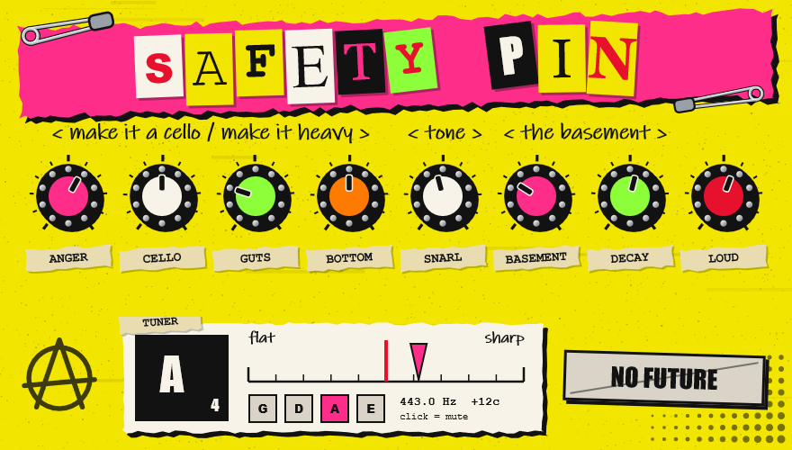

  

  
  
  

---

# Safety Pin
### Electric violin distortion

**Safety Pin is a distortion made for electric violin**: a fat, bassy fuzz that tames bow scratch
and fizz, with an octave-down voice that turns the violin into a cello, a sub bass two octaves
down, a plate reverb and a built-in violin tuner.
64-bit **VST3** and **standalone app** for Windows (ASIO, e.g. a Focusrite Scarlett). Mono in, stereo out.

It works on other instruments too (guitar, viola, voice), but the pitch tracking for CELLO, GUTS
and the tuner is set to the violin's range (about 150 Hz and up).

  

Made by Farica Kimora. &copy; Cursed Entertainment

## Controls

| Knob | Does |
|---|---|
| ANGER | drive |
| CELLO | real octave down; full = only the octave (a cello) |
| GUTS | synth sub bass two octaves down |
| BOTTOM | bass boost after the distortion (0 to +14 dB at 120 Hz) |
| SNARL | tone, dark to bright |
| BASEMENT | reverb mix |
| DECAY | reverb length |
| LOUD | output level |
| OVERKILL | +12 dB and hard clipping |

**Tuner:** standard violin tuning (G D A E, A = 440 Hz), listening to the clean input before any
effect. Shows the note, cents and the nearest string; click it to mute the output while tuning.

ANGER at 0 and CELLO up gives a clean cello. CELLO and GUTS follow one note at a time; double stops confuse them.

## Build (Windows)
Needs Visual Studio 2022 (Desktop development with C++) and CMake 3.22+. JUCE 8.0.12 is downloaded
into `build/` on the first configure.

Easiest: double-click **`build.bat`**. It builds both and puts `Safety Pin.exe` and `Safety Pin.vst3`
in the `dist` folder. By hand:

    cmake -S . -B build -G "Visual Studio 17 2022" -A x64
    cmake --build build --config Release --parallel --target SafetyPin_VST3 SafetyPin_Standalone

- Standalone: `build/SafetyPin_artefacts/Release/Standalone/Safety Pin.exe`
- VST3: `build/SafetyPin_artefacts/Release/VST3/Safety Pin.vst3` - copy it to `C:\Program Files\Common Files\VST3`

## Standalone with an audio interface
Options > Audio/MIDI Settings: driver type ASIO, device e.g. Focusrite USB ASIO, input = the one the
violin is plugged into, buffer 64-128 samples. Then click "Unmute Input" (JUCE mutes inputs on
first start to avoid feedback; use headphones or an amp, not a mic near the speakers).

## Offline test
`SafetyPinRender <dir>` (target `SafetyPinRender`) checks the tuner, renders the window to `gui.png`
and runs a synthetic violin through the effect at a few settings into WAV files.

## How it works
- **Octave down:** two read heads sweep a delay line at half speed and crossfade; the sweep is a whole
  number of the note's periods, so the splices land in phase.
- **Sub bass:** a flip-flop octave divider (like the old analog octave pedals), shaped by the input's envelope.
- **Distortion:** bow scratch cut and low mids pushed before the clipper, 4x oversampled tanh / hard clip.
- **Reverb:** Jon Dattorro's plate (JAES 1997), damped darker for strings.
- **Tuner:** YIN pitch detection (de Cheveigne & Kawahara 2002) on the clean input.

## Licence
The Safety Pin source code is MIT licensed (see [LICENSE](LICENSE)). It is built with
[JUCE](https://juce.com), which is under its own licence (AGPLv3 or a commercial JUCE licence), and
the standalone app uses Steinberg's ASIO interface bundled with JUCE. Anyone distributing compiled
builds must follow those licences too.

---

 

© Cursed Entertainment 2026

 

 

  

---
